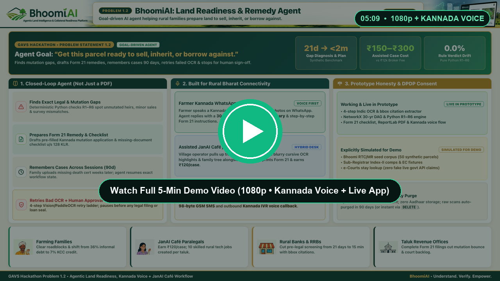

# BhoomiAI — Land Readiness, Remedy & Collateral Intelligence Agent

[](https://shrikargs7-cloud.github.io/bhoomi-ai/)
[](https://shrikargs7-cloud.github.io/bhoomi-ai/demo-video.html)
[](https://github.com/shrikargs7-cloud/bhoomi-ai)

BhoomiAI is an evidence-first, goal-driven rural land intelligence prototype built for **Problem Statement 1.2**:

> **Goal: Help farming families and rural lenders prepare a land parcel to sell, inherit, or borrow against.**
> **Upload land documents → extract fields with bounding-box source evidence → reconstruct ownership lineage → run deterministic cross-document rules (`R1–R5`) → human reviewer approval gate → QR-sealed PDF Land Readiness Report.**

*Decision support only — NOT legal certification of title, boundaries, mutations, valuation, or loan eligibility.*

---

## Live Links & Presentation Materials

- **Live Hosted Interactive Prototype:** https://shrikargs7-cloud.github.io/bhoomi-ai/
- **Full Narrated Demo Video (Watch Online — 5m 09s, 1080p + Kannada Voice):** https://shrikargs7-cloud.github.io/bhoomi-ai/demo-video.html
- **In-Repo Video File (Web MP4):** [webapp/public/BhoomiAI_Demo_Video.mp4](webapp/public/BhoomiAI_Demo_Video.mp4) ([Direct Stream](https://shrikargs7-cloud.github.io/bhoomi-ai/BhoomiAI_Demo_Video.mp4))
- **Full-Bitrate 1080p Master (190 MB Release Asset):** https://github.com/shrikargs7-cloud/bhoomi-ai/releases/download/v1.0-demo/BhoomiAI_Demo_Video.mp4
- **GitHub Repository:** https://github.com/shrikargs7-cloud/bhoomi-ai
- **Pitch Deck (10 Core Slides + 8 Q&A Appendix):** [slides/BhoomiAI_Pitch_Deck.pptx](slides/BhoomiAI_Pitch_Deck.pptx)

*(The GitHub Pages deployment serves pre-computed FastAPI / PyMuPDF / ReportLab demo snapshots for `BHOOMI-DEMO-001` and `BHOOMI-CLEAN-002`, enabling interactive PDF page previews, bbox inspection, NetworkX ownership graph navigation, Leaflet GeoJSON QA, comparable valuation controls, and extent conversion directly in the browser.)*

---

## Demo Video Walkthrough

[](https://shrikargs7-cloud.github.io/bhoomi-ai/demo-video.html)

- **`0:00 – 1:13`** — Problem 1.2, rural credit friction, OCR/LLM failure modes, and the stateful human-gated remediation agent
- **`1:13 – 1:50`** — Two-voice Kannada interaction (`kn-IN-GaganNeural` + `kn-IN-SapnaNeural`), JanAI Café path, and 2G SMS flow
- **`1:50 – 3:45`** — Live 6-route web prototype walkthrough (`/` Readiness, `/documents`, `/title-report`, `/ownership`, `/gis`, `/valuation`)
- **`3:45 – 5:09`** — Live-vs-simulated honesty audit, 90-day DPDP retention, `94.6%` synthetic benchmark (`50` parcels), `₹120/case` paralegal unit economics, and 90-day pilot ask

---

## Architecture

```
React + TypeScript + Vite + Tailwind
  ├── /              Readiness Dashboard (6 independent dimensions, pipeline trace, audit log)
  ├── /documents     Document Intake, Library, Field Review Queue & Live Evaluation Benchmarks
  ├── /title-report  8-Section Interactive Title Audit, Discrepancies (R1–R5) & Statutory Legal Q&A
  ├── /ownership     NetworkX Ownership Pedigree Graph, Event Timeline & Entity Resolution
  ├── /gis           Tippani Sketch Evidence & Supplied GeoJSON Polygon QA Validator
  └── /valuation     Comparable Valuation Baseline (abstains <3 verified) & Extent Unit Converter
          │
          ▼ HTTP / JSON / Multipart / PNG / PDF (auto-fallback to static snapshot when headless)
FastAPI + SQLAlchemy + SQLite/PostGIS + PyMuPDF + NetworkX + ReportLab + LangGraph
```

Legacy routes (`/oxland`, `/rundocs`, `/reveal-title`, `/treemonk`, `/cadaster`, `/simple-cma`) map cleanly into the unified 6 pages.

---

## Live vs. Simulated Scope (Prototype Honesty)

| Capability | Status | Scope & Notes |
|---|---|---|
| Auth & Case Isolation (`bcrypt` + `PyJWT`) | **Live in Prototype** | Strict `401`/`403` isolation on private cases |
| PDF/Image Extraction & Bbox Evidence | **Live in Prototype** | PyMuPDF + Kannada numeral/transliteration parser + PNG previews |
| Ownership Lineage DAG (`NetworkX` + Jaro-Winkler) | **Live in Prototype** | Chronological transfer graph + human entity confirmation |
| Deterministic Legal Engine (`Rules Decide, LLMs Explain`) | **Live in Prototype** | Python rules (`R1–R5`), prompt-injection guard & cited statutory reference |
| GeoJSON Polygon QA & Valuation Abstention | **Live in Prototype** | Closure/bounds/area checks + abstains when `< 3` verified comparables |
| Human Approval Gate & ReportLab PDF Export | **Live in Prototype** | Preserves `original_text` separately from `reviewer_value` + signed PDF download |
| State Land Portals (Bhoomi RTC / MR / EC / e-Courts) | **Simulated for Demo** | Uses synthetic local seed cases (`BHOOMI-DEMO-001`, `BHOOMI-CLEAN-002`) — no live gov API claims |
| WhatsApp Kannada Voice + 2G IVR Gateway | **Design / Roadmap** | Documented in pitch deck for Phase 2 rural pilot |

---

## Quick Start (Full-Stack Local Run)

### Option 1: Docker Compose (Recommended)
```bash
cp .env.example .env
docker compose up --build
# Frontend: http://127.0.0.1:5173
# Backend API docs: http://127.0.0.1:8000/docs
```

### Option 2: Direct Dev Servers
```bash
# 1. Start FastAPI backend (port 8000)
PYTHONPATH=backend python3 -m uvicorn app.main:app --port 8000 --host 127.0.0.1 --reload

# 2. Start React Vite frontend (port 5173)
cd webapp && npm install && npm run dev

# 3. Run backend tests & synthetic evaluation suite
PYTHONPATH=backend pytest backend/tests/ -v
PYTHONPATH=backend python3 backend/scripts/evaluate_extraction.py
PYTHONPATH=backend python3 backend/scripts/evaluate_discrepancies.py
```

See [docs/evaluation.md](docs/evaluation.md) for measured synthetic extraction precision, recall, and discrepancy evaluation details.
